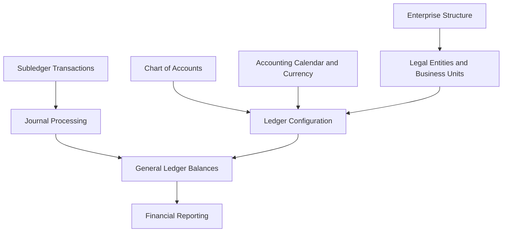
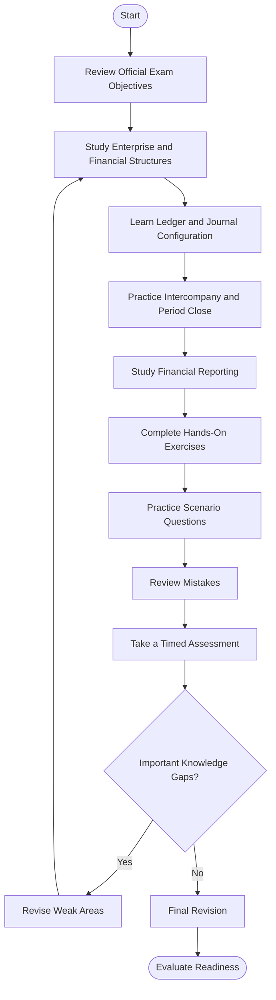
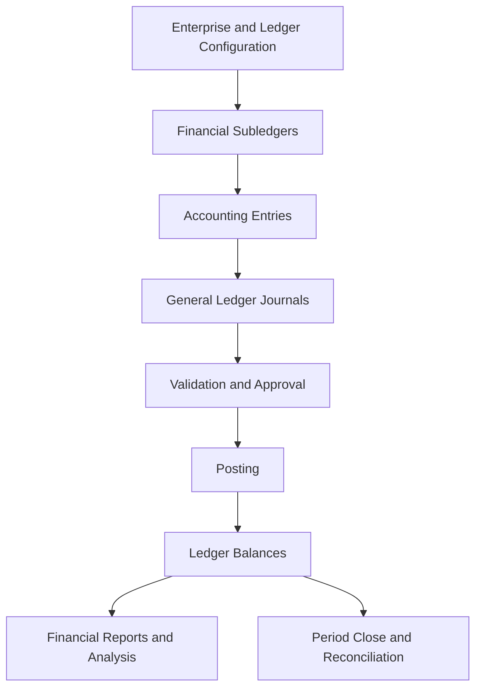
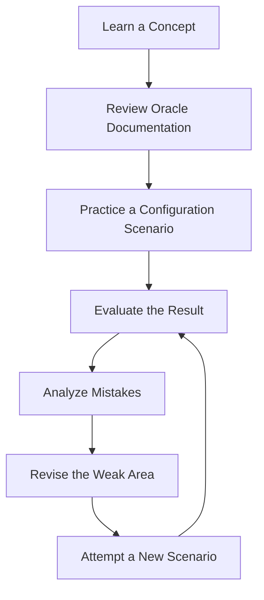
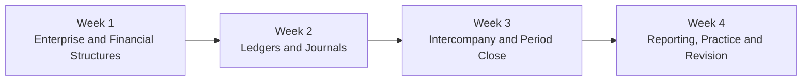

# Oracle Fusion Cloud Financials: General Ledger 2026 Implementation Professional (1Z0-1054-26)

A practical study guide for the **Oracle Fusion Cloud Financials: General Ledger 2026 Implementation Professional** certification. This repository helps candidates understand enterprise financial structures, chart of accounts configuration, ledger setup, journal processing, intercompany accounting, accounting period close, and financial reporting.

The goal is to build implementation knowledge that can be applied to realistic Oracle Cloud Financials scenarios rather than relying solely on memorized answers.

- **Exam code:** `1Z0-1054-26`
- **Certification provider:** Oracle
- **Product:** Oracle Fusion Cloud Financials — General Ledger
- **Official certification exam:** [Oracle MyLearn — 1Z0-1054-26](https://mylearn.oracle.com/ou/exam/oracle-fusion-cloud-financials-general-ledger-2026-implementation-professional-1z0-1054-26/107076/158916/264898)
- **Official learning path:** [Become a Certified Financials General Ledger Implementer](https://mylearn.oracle.com/ou/learning-path/become-a-certified-financials-general-ledger-implementer/96455)
- **Additional preparation resource:** [CertsGate — 1Z0-1054-26](https://certsgate.com/exams/oracle/1z0-1054-26)

## Table of Contents

- [About the Certification](#about-the-certification)
- [Who Should Prepare for This Exam?](#who-should-prepare-for-this-exam)
- [Exam Information](#exam-information)
- [Skills and Knowledge Areas](#skills-and-knowledge-areas)
- [Official Exam Objectives](#official-exam-objectives)
- [Understanding Oracle General Ledger](#understanding-oracle-general-ledger)
- [Conceptual Financial Structures Map](#conceptual-financial-structures-map)
- [Certification Preparation Flowchart](#certification-preparation-flowchart)
- [General Ledger Architecture Diagram](#general-ledger-architecture-diagram)
- [Study and Revision Cycle](#study-and-revision-cycle)
- [Step-by-Step Preparation Guide](#step-by-step-preparation-guide)
- [Recommended Study Schedule](#recommended-study-schedule)
- [Practice Questions and Mock Tests](#practice-questions-and-mock-tests)
- [Hands-On Exercises](#hands-on-exercises)
- [Common Preparation Mistakes](#common-preparation-mistakes)
- [Career Relevance](#career-relevance)
- [Frequently Asked Questions](#frequently-asked-questions)
- [Official and Additional Learning Resources](#official-and-additional-learning-resources)
- [About CertsGate](#about-certsgate)
- [Disclaimer](#disclaimer)

---

## About the Certification

The Oracle Fusion Cloud Financials: General Ledger 2026 Implementation Professional certification focuses on implementing and configuring General Ledger capabilities within Oracle Fusion Cloud Financials.

General Ledger provides a central accounting framework for recording financial activity, maintaining account balances, processing journals, supporting period-end close, and producing financial reports.

Successful implementation requires an understanding of how enterprise structures, ledgers, accounting calendars, currencies, and the chart of accounts fit together. Candidates also need to understand journal processing, intercompany transactions, financial reporting, and the controls that help organizations maintain consistent accounting information.

Oracle identifies this certification as a hands-on performance-based assessment. Preparation should therefore combine conceptual study with practice interpreting requirements and working through relevant application configurations.

Start with the [official Oracle certification exam page](https://mylearn.oracle.com/ou/exam/oracle-fusion-cloud-financials-general-ledger-2026-implementation-professional-1z0-1054-26) to review the current exam topics.

## Who Should Prepare for This Exam?

This certification is relevant to professionals such as:

- Oracle Fusion Cloud Financials implementation consultants.
- General Ledger functional consultants.
- Financial systems administrators.
- ERP implementation specialists.
- Financial reporting and accounting systems analysts.
- Finance professionals moving into Oracle Cloud ERP implementation.
- Consultants supporting enterprise accounting configuration and period close.

Experience with accounting principles, general ledger processes, financial statements, and enterprise resource planning systems can make the subject easier to understand.

Candidates without Oracle experience should begin with accounting terminology and the purpose of the General Ledger before studying advanced implementation scenarios.

## Exam Information

The following details are published on Oracle's MyLearn exam page for this certification.

| Item | Official information |
|---|---|
| Certification | Oracle Fusion Cloud Financials: General Ledger 2026 Implementation Professional |
| Exam code | 1Z0-1054-26 |
| Provider | Oracle |
| Delivery | Proctored online |
| Format | Hands-on performance-based |
| Duration | 90 minutes |
| Number of questions | 36 |
| Passing score | 68% |
| Official learning path | Become a Certified Financials General Ledger Implementer |

Source: [Oracle MyLearn — Exam 1Z0-1054-26](https://mylearn.oracle.com/ou/exam/oracle-fusion-cloud-financials-general-ledger-2026-implementation-professional-1z0-1054-26/107076/158916/264898).

Exam policies and delivery arrangements can change. Check the official exam page before registering.

## Skills and Knowledge Areas

The exam covers several connected implementation areas.

| Knowledge area | What to understand |
|---|---|
| Enterprise structures | Enterprise organization, legal entities, jurisdictions, geographies, and related setup |
| Financial reporting structures | Chart of accounts, account hierarchies, accounting calendars, currencies, and security |
| Ledger configuration | Primary ledgers, additional ledgers, ledger options, and General Ledger security |
| Journal processing | Journal sources, categories, creation, validation, posting, and approvals |
| Intercompany accounting | Intercompany configuration, transactions, balancing, and reconciliation |
| Period close | Accounting periods, close activities, monitoring, and related accounting processes |
| Financial reporting | General Ledger balances, financial reports, account analysis, and reporting configuration |
| Automation and newer features | Relevant AI, machine learning, mobile, automation, and Redwood functionality included in the current objectives |

These areas should be studied using the exact objective wording published by Oracle. Do not assume that every topic has equal examination weight.

## Official Exam Objectives

Oracle's MyLearn exam page publishes the certification topics and related learning objectives.

### 1. Implementing Enterprise and Financial Reporting Structures

Study how enterprise configuration supports financial operations.

Focus on:

- The fundamental structure of an enterprise.
- Legal entities, legal jurisdictions, and geographies.
- Chart of accounts design.
- Financial reporting structures.
- Account hierarchies and related configuration.
- Accounting calendars and currencies.
- Chart of accounts security.

### 2. Implementing Ledgers

Understand how ledgers support financial accounting.

Study:

- Ledger configuration.
- Ledger options and associated accounting settings.
- General Ledger security.
- General Ledger balances cubes and their purpose.
- Relationships among ledgers, legal entities, and subledgers.

### 3. Implementing and Managing Journals

Understand the journal lifecycle and the controls around it.

Review:

- Journal sources and categories.
- Journal creation from different sources.
- Journal validation and posting.
- Journal approval rules.
- Journal processing and troubleshooting.

### 4. Processing Intercompany Transactions

Study how organizations account for transactions between related entities.

Focus on:

- Intercompany configuration.
- Intercompany transaction processing.
- Balancing requirements.
- Reconciliation and troubleshooting.

### 5. Performing Period Close

Understand the activities involved in closing accounting periods.

Review:

- Accounting period status and control.
- Period-close dependencies.
- Monitoring close activities.
- Revaluation and other relevant close processes.
- Investigation of errors that prevent completion.

### 6. Configuring Financial Reports

Study how General Ledger information is presented and analyzed.

Focus on:

- Financial Reporting Center configuration.
- Financial reports and analysis.
- General Ledger account balances.
- Report setup and validation.

### 7. Newer Features and Automation

Oracle's 2026 objectives also include relevant AI, machine learning, mobile, automation, and Redwood-related features.

Review the exact current objective wording and corresponding Oracle learning material for these topics. Avoid assuming that functionality from an earlier release behaves identically in the 2026 release.

**Official sources:**

- [Oracle MyLearn — Exam objectives](https://mylearn.oracle.com/ou/exam/oracle-fusion-cloud-financials-general-ledger-2026-implementation-professional-1z0-1054-26/107076/158916/264898)
- [Oracle Financials implementation documentation](https://docs.oracle.com/en/cloud/saas/financials/26d/facsf/index.html)
- [Implementing Enterprise Structures and General Ledger](https://docs.oracle.com/en/cloud/saas/financials/26d/faigl/index.html)

## Understanding Oracle General Ledger

Oracle General Ledger is a core part of enterprise accounting. It provides the framework for recording journal entries, maintaining balances, and supporting financial analysis.

Three concepts deserve particular attention:

**Chart of accounts:** Defines the account structure used to classify financial activity. Its segments can represent dimensions such as company, cost center, and natural account, depending on the organization's design.

**Ledger:** Determines important accounting settings, including the chart of accounts, accounting calendar, currency, and accounting method.

**Subledger:** Captures detailed transactions for business processes such as supplier invoices, customer activity, and asset acquisitions. Accounting entries can then be transferred to General Ledger.

These concepts are related but not interchangeable. A clear understanding of their roles helps when analyzing configuration requirements and troubleshooting accounting results.

Read the official [Oracle documentation on ledgers and subledgers](https://docs.oracle.com/en/cloud/saas/financials/26a/faigl/ledgers-and-subledgers.html).

## Conceptual Financial Structures Map

This independent study diagram shows how common enterprise and accounting components relate to General Ledger. It is not an official Oracle architecture diagram or an exam-weightage chart.

Use this model to ask practical questions:

- Which accounting settings are determined by a ledger?
- Why does the chart of accounts matter for financial reporting?
- How do subledger transactions contribute to General Ledger balances?
- What needs to be checked when a journal cannot be posted?
- How can configuration choices affect reporting and reconciliation?

## Certification Preparation Flowchart

A structured process helps candidates move from foundational knowledge to implementation practice.

Do not move directly from reading to repeated testing without reviewing mistakes. Every incorrect or uncertain answer should identify a concept that needs further work.

## General Ledger Architecture Diagram

The following diagram illustrates a conceptual accounting flow. The exact process depends on the configured Oracle Financials environment and transaction type.

This model helps connect the implementation topics. Enterprise setup establishes the accounting framework; transactions produce accounting entries; journal processing and posting update ledger balances; reporting and close activities use those balances.

For product-specific details, consult the [Oracle General Ledger implementation guide](https://docs.oracle.com/en/cloud/saas/financials/26d/faigl/index.html).

## Study and Revision Cycle

General Ledger preparation is iterative. A practice attempt should help you discover a gap, revisit the underlying configuration, and test your understanding again.

For example, if you misunderstand how a ledger relates to the chart of accounts and accounting calendar, revisit the relevant documentation, explain the relationship in your own words, and then work through a different scenario.

The objective is to develop reasoning skills, not simply remember the correct response to a familiar question.

## Step-by-Step Preparation Guide

### Step 1: Establish Your Accounting Foundation

Review core accounting concepts such as debits, credits, journal entries, account balances, trial balances, and financial statements.

If you already understand accounting, focus on how these concepts are represented in Oracle Fusion Cloud Financials.

### Step 2: Study Enterprise and Financial Structures

Learn the roles of enterprise structures, legal entities, business units, chart of accounts, accounting calendars, and currencies.

Pay particular attention to how these components fit together during implementation. Configuration decisions should reflect the organization's accounting and reporting requirements.

### Step 3: Understand Ledger Configuration

Study how ledgers are defined and which accounting settings they control.

Review primary ledgers, optional secondary ledgers, reporting currencies, and General Ledger security where relevant to the official objectives.

Use Oracle documentation to understand prerequisites and validate how configuration choices affect downstream accounting.

### Step 4: Practice Journal Processing

Learn the journal lifecycle from creation and validation through approval and posting.

Practice explaining the purpose of journal sources and categories. Review how errors can affect processing and what an administrator should investigate before making configuration changes.

### Step 5: Learn Intercompany Accounting

Study how related entities account for transactions between themselves.

Focus on the configuration requirements, balancing rules, transaction processing, and reconciliation. Work through examples that explain why an intercompany entry needs particular accounting treatment.

### Step 6: Understand Period Close

Review accounting periods and the activities involved in closing them.

Understand the dependencies between accounting transactions, journal posting, reconciliation, and close monitoring. Learn how to investigate incomplete close activities using the documented Oracle workflow.

### Step 7: Study Financial Reporting

Explore the Financial Reporting Center, General Ledger balances, and the reporting options relevant to the certification.

Practice connecting a reporting requirement with the underlying account structure and ledger information. Learn how to check whether a reporting issue originates in configuration, accounting data, or report setup.

### Step 8: Review Automation and Release-Specific Features

Use the official 2026 objectives and Oracle learning material to identify the relevant AI, machine learning, mobile, automation, and Redwood features.

Verify current product behavior instead of relying on assumptions based on older releases.

### Step 9: Complete Practical Exercises

Where possible, use an authorized Oracle training environment to perform relevant setup and accounting tasks.

If you cannot access an environment, trace the documented workflows and work through original scenario exercises.

### Step 10: Assess Readiness

Complete practice questions after studying the related concepts. Review mistakes, revisit documentation, and test your understanding with new scenarios.

Finish by evaluating your knowledge across the official objectives and the applicable hands-on assessment format.

## Recommended Study Schedule

The following four-week plan is an independent recommendation, not an official Oracle requirement.

| Period | Study focus | Suggested outcome |
|---|---|---|
| Week 1 | Enterprise structures, chart of accounts, calendars, currencies | Understand the accounting configuration foundation |
| Week 2 | Ledger setup, security, journals, approvals, posting | Explain the journal lifecycle and ledger relationships |
| Week 3 | Intercompany accounting and period close | Understand processing dependencies and reconciliation |
| Week 4 | Financial reporting, newer features, practice, revision | Identify and address remaining knowledge gaps |

Adjust the schedule to your accounting background, Oracle experience, available study time, and access to practical exercises.

If you already work with General Ledger, spend more time on unfamiliar configuration tasks and release-specific objectives. If you are new to Oracle Cloud Financials, build a stronger foundation before attempting timed practice.

## Practice Questions and Mock Tests

Practice questions help identify misunderstandings, but they are most useful when paired with explanation and review.

The [CertsGate 1Z0-1054-26 preparation page](https://certsgate.com/exams/oracle/1z0-1054-26) is a supplementary resource to explore alongside official Oracle materials.

Use the following review method:

1. Identify the accounting or implementation requirement in the scenario.
2. Determine which General Ledger feature or configuration area applies.
3. Select an answer based on the documented behavior.
4. Explain why the selected approach meets the requirement.
5. Review why the alternatives may be unsuitable.
6. Map mistakes to the relevant objective.
7. Revisit official documentation and attempt a different scenario.

### Original Conceptual Practice Exercises

These examples are independent educational exercises, not actual or official Oracle exam questions.

**Question 1: Ledger Configuration**

An implementation consultant is configuring a ledger. Which group of settings is central to defining its accounting framework?

A. Chart of accounts, accounting calendar, and currency.

B. Browser theme, screen resolution, and desktop wallpaper.

C. Email signature and calendar notifications.

D. External marketing campaign settings.

**Learning focus:** Ledger configuration and its core accounting settings.

**Question 2: Journal Processing**

A journal has been entered but has not updated the ledger balances. Which step should the administrator investigate as part of the journal lifecycle?

A. Whether the journal has completed the required validation, approval, and posting steps.

B. Whether the user's desktop wallpaper is configured.

C. Whether an unrelated marketing application is available.

D. Whether every enterprise employee has unrestricted access.

**Learning focus:** Journal processing and posting.

**Question 3: Financial Reporting**

An organization needs financial reports based on its account balances. Which area is most directly relevant?

A. General Ledger financial reporting and analysis.

B. Browser cache settings alone.

C. External email distribution lists alone.

D. Unrelated network routing.

**Learning focus:** General Ledger balances and financial reporting.

**Question 4: Intercompany Accounting**

Two related legal entities conduct a transaction that requires intercompany accounting. What should an implementation consultant investigate?

A. The relevant intercompany configuration, transaction processing, and balancing requirements.

B. The employee's desktop display settings.

C. The organization's unrelated website theme.

D. A change to the chart of accounts without analyzing the requirement.

**Learning focus:** Intercompany processing and balancing.

These exercises test general reasoning. Validate the detailed configuration and correct product behavior through Oracle's documentation and learning resources.

## Hands-On Exercises

Practical learning helps connect accounting concepts with the Oracle application.

Use an authorized training environment when available. Do not experiment with production financial records or make unauthorized configuration changes.

| Exercise | Learning objective |
|---|---|
| Review enterprise structures | Understand the organization supporting financial operations |
| Explore a chart of accounts | Understand segments and account combinations |
| Examine ledger settings | Connect accounting calendars, currencies, and account structures |
| Trace a journal lifecycle | Understand validation, approval, and posting |
| Review intercompany processing | Understand balancing and reconciliation |
| Examine period-close tasks | Identify dependencies and incomplete activities |
| Explore financial reports | Connect ledger balances with reporting requirements |
| Investigate a configuration error | Develop a systematic troubleshooting process |

For each exercise, document the business requirement, relevant setup, prerequisites, expected outcome, and validation steps.

If a practice environment is unavailable, use the official implementation guide to trace the workflow and explain what each configuration task is intended to accomplish.

## Common Preparation Mistakes

### Memorizing Questions Instead of Understanding Accounting

A memorized answer will not necessarily help with a different scenario. Understand why a configuration or accounting treatment meets the requirement.

### Confusing the Chart of Accounts with a Ledger

The chart of accounts defines the structure used to classify financial activity. A ledger includes additional accounting settings. Learn how these concepts work together.

### Ignoring Journal Processing Steps

Understand the distinctions among creating, validating, approving, and posting journals. These steps have different purposes and can affect accounting results.

### Skipping Intercompany Scenarios

Intercompany accounting involves relationships between entities, transaction processing, and balancing requirements. Study the workflow rather than memorizing isolated definitions.

### Treating Period Close as a Single Action

Period close depends on multiple accounting activities and controls. Understand the relevant dependencies and how to investigate incomplete tasks.

### Ignoring Financial Reporting

Configuration knowledge should include how account structures and ledger balances support reporting and analysis.

### Relying Only on Third-Party Questions

Supplementary practice materials cannot replace official exam objectives, Oracle documentation, or practical learning.

### Failing to Review Incorrect Answers

Keep a record of recurring mistakes and the concepts behind them. Revisit those concepts before attempting more questions.

## Career Relevance

General Ledger implementation knowledge can be useful for professionals working with enterprise accounting systems, financial operations, and ERP implementation projects.

Potentially related roles include:

- Oracle Financials functional consultant.
- General Ledger implementation consultant.
- Oracle Cloud ERP administrator.
- Financial systems analyst.
- ERP financial reporting consultant.
- Accounting systems specialist.

Actual job requirements vary by organization, experience, and project responsibilities.

Certification preparation can strengthen product knowledge, but it does not replace accounting expertise, practical implementation experience, communication skills, or familiarity with an organization's financial processes.

## Frequently Asked Questions

### What is the Oracle 1Z0-1054-26 certification?

It is the Oracle Fusion Cloud Financials: General Ledger 2026 Implementation Professional certification.

### What is the exam duration and passing score?

Oracle's published exam listing specifies 90 minutes, 36 questions, and a 68% passing score. Verify the current information on the official exam page before registration.

### Is the exam hands-on?

Oracle identifies this certification as a hands-on performance-based exam delivered through a proctored online format. Preparation should include both conceptual understanding and application-oriented practice.

### Which topics should I prioritize?

Start with the official objectives covering enterprise and financial reporting structures, ledgers, journals, intercompany accounting, period close, financial reporting, and relevant newer features.

### Are practice questions sufficient?

No. Combine practice questions with official documentation, Oracle's learning path, accounting fundamentals, and practical exercises where available.

### How long should I study?

Preparation time depends on your accounting background, Oracle experience, current knowledge gaps, and access to a practice environment. The four-week plan in this repository is a suggested framework rather than an official requirement.

### Where can I find additional practice resources?

Start with [Oracle MyLearn](https://mylearn.oracle.com/ou/learning-path/become-a-certified-financials-general-ledger-implementer/96455), consult the [Oracle General Ledger documentation](https://docs.oracle.com/en/cloud/saas/financials/26d/faigl/index.html), and explore the supplementary [CertsGate 1Z0-1054-26 page](https://certsgate.com/exams/oracle/1z0-1054-26).

### Does this README guarantee a passing result?

No. It is an independent educational resource intended to support structured preparation. Your result depends on your knowledge, practical ability, and performance under the applicable assessment conditions.

## Official and Additional Learning Resources

Use Oracle's official resources as the foundation of your preparation.

| Resource | Purpose |
|---|---|
| [Oracle MyLearn — 1Z0-1054-26](https://mylearn.oracle.com/ou/exam/oracle-fusion-cloud-financials-general-ledger-2026-implementation-professional-1z0-1054-26/107076/158916/264898) | Review exam information and official objectives |
| [Become a Certified Financials General Ledger Implementer](https://mylearn.oracle.com/ou/learning-path/become-a-certified-financials-general-ledger-implementer/96455) | Follow the structured learning path |
| [Implementing Enterprise Structures and General Ledger](https://docs.oracle.com/en/cloud/saas/financials/26d/faigl/index.html) | Study implementation and configuration |
| [Using General Ledger](https://docs.oracle.com/en/cloud/saas/financials/26d/faugl/index.html) | Learn about journals, period close, reporting, and General Ledger functionality |
| [Getting Started with Financials Implementation](https://docs.oracle.com/en/cloud/saas/financials/26d/facsf/index.html) | Understand implementation tasks and setup workflows |
| [CertsGate — 1Z0-1054-26](https://certsgate.com/exams/oracle/1z0-1054-26) | Explore supplementary certification preparation material |
| [CertsGate](https://certsgate.com/) | Browse additional IT certification preparation resources |

Documentation versions can differ from the exact exam release. Use the current exam objectives to determine which documentation and release-specific topics are relevant.

## About CertsGate

[CertsGate.com](https://certsgate.com/) provides supplementary IT certification preparation resources for learners studying different professional certifications.

The dedicated [Oracle 1Z0-1054-26 preparation page](https://certsgate.com/exams/oracle/1z0-1054-26) is a starting point for exploring resources related to this General Ledger certification.

Third-party practice material can help reinforce concepts and identify weak areas. Use it alongside Oracle's official learning path, product documentation, and practical exercises rather than as a replacement for them.
